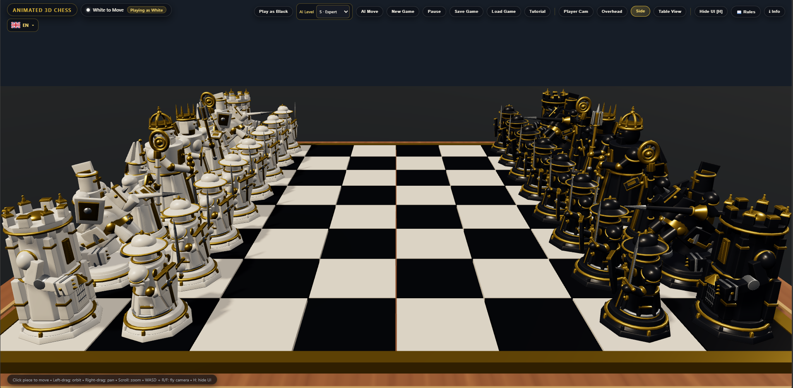
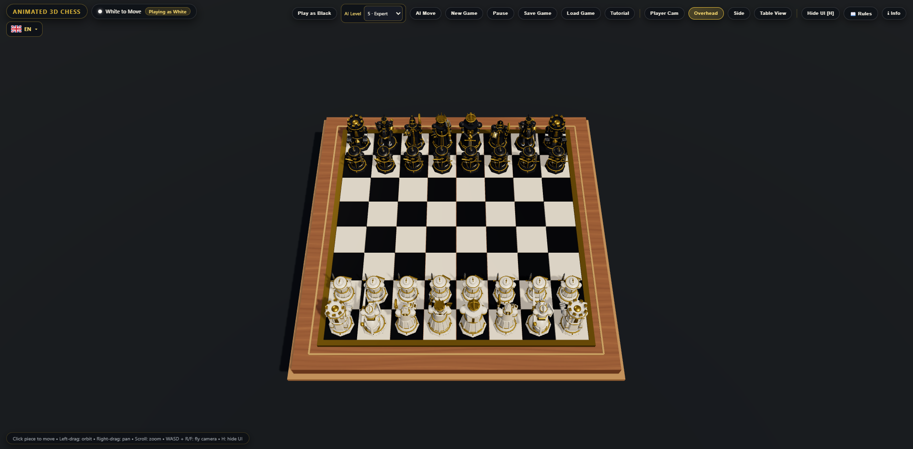

# ANIMATED 3D CHESS



*Real gameplay screenshot / Stvarna snimka igre / Echter Spiel-Screenshot / Screenshot reale del gioco / Captura real del juego.*
**Wizard Chess 3D — Table Edition** · **Apps & Games**

**Choose your language / Odaberi jezik / Sprache wählen / Scegli la lingua / Elige el idioma:**

[🇬🇧 English](#english) · [🇭🇷 Hrvatski](#hrvatski) · [🇩🇪 Deutsch](#deutsch) · [🇮🇹 Italiano](#italiano) · [🇪🇸 Español](#español)

## Screenshots / Snimke zaslona / Bildschirmfotos / Schermate / Capturas de pantalla

<p align="center">
  <a href="docs/images/gameplay-overhead.png"></a>
  <a href="docs/images/gameplay-side.png"></a>
</p>
---

## English

**Animated 3D Chess — Table Edition** is a browser-based 3D chess game built with React, Three.js, TypeScript and Vite.

### Features

- An animated 3D chessboard with camera rotation, panning and zoom.
- **Play against the computer** with six difficulty levels (level 6: Stockfish), using a local chess opponent.
- **Two players on the same device** (pass-and-play).
- Choose a side, start a new game, pause and resume.
- **Save and load** an offline game (vs computer or two local players) in the same browser on the same device.
- A beginner tutorial showing how all six types of chess piece move, with highlighted movement and capture squares.
- Interface languages: **English, Croatian, German, Italian and Spanish**.
- Responsive board for different browser-window sizes.

### Run locally

**Requirements:** Node.js and npm. From the project folder:

```bash
npm install
npm run dev
```

Open the local URL displayed by Vite (normally `http://localhost:3000`). To check types and build:

```bash
npm run lint
npm run build
```

### Controls and notes

**Click** a piece and its destination; **left drag** rotates the camera; **right drag** pans; **mouse wheel** zooms; **H** hides or restores the interface. Further controls are available on screen.

Gameplay against the computer runs locally: **no Gemini API key is needed to play**. Saved games use local browser storage; clearing browser data may delete them. Saving/loading supports both offline game modes. Online multiplayer is not included in this version.

### Credits

If you use our source code to create your own version, we'd appreciate a mention in its About / Info section:

**Based on ANIMATED 3D CHESS by Apps & Games — [appsandgames.org](https://appsandgames.org/)**

---

## Hrvatski

**Animated 3D Chess — Table Edition** je 3D šahovska igra za internetski preglednik, izrađena tehnologijama React, Three.js, TypeScript i Vite.

### Mogućnosti

- Animirana 3D šahovnica s okretanjem kamere, pomicanjem pogleda i zumiranjem.
- **Igra protiv računala** sa šest razina težine (6. razina: Stockfish) i lokalnim šahovskim protivnikom.
- **Dva igrača na istom uređaju**, naizmjeničnim potezima.
- Odabir boje, nova igra, pauziranje i nastavak partije.
- **Spremanje i učitavanje** izvanmrežne partije (protiv računala ili lokalno dvoje igrača) u istom pregledniku i na istom uređaju.
- Početnički tutorijal za svih šest vrsta figura s označenim poljima kretanja i uzimanja.
- Jezici sučelja: **engleski, hrvatski, njemački, talijanski i španjolski**.
- Prilagodba šahovnice različitim veličinama prozora.

### Lokalno pokretanje

**Potrebno:** Node.js i npm. U mapi projekta pokreni:

```bash
npm install
npm run dev
```

Otvori lokalnu adresu koju prikaže Vite (obično `http://localhost:3000`). Za provjeru tipova i izgradnju:

```bash
npm run lint
npm run build
```

### Upravljanje i napomene

**Klikom** odaberi figuru i odredišno polje; **povlačenjem lijevom tipkom** okreći kameru; **desnom tipkom** pomiči pogled; **kotačićem miša** zumiraj; **H** skriva ili ponovno prikazuje sučelje. Dodatne mogućnosti nalaze se na zaslonu.

Protivnik radi lokalno: **za igranje nije potreban Gemini API ključ**. Spremljene partije nalaze se u lokalnoj pohrani preglednika; brisanje podataka preglednika može ih ukloniti. Spremanje i učitavanje podržava oba izvanmrežna načina igranja. Mrežni multiplayer nije dio ove verzije.

### Zasluge

Ako koristiš naš izvorni kod za vlastitu verziju igre, bili bismo zahvalni da nas spomeneš u odjeljku O aplikaciji / Info:

**Temeljeno na igri ANIMATED 3D CHESS autora Apps & Games — [appsandgames.org](https://appsandgames.org/)**

---

## Deutsch

**Animated 3D Chess — Table Edition** ist ein browserbasiertes 3D-Schachspiel, entwickelt mit React, Three.js, TypeScript und Vite.

### Funktionen

- Animiertes 3D-Schachbrett mit drehbarer, verschiebbarer und zoombarer Kamera.
- **Gegen den Computer spielen** – mit sechs Schwierigkeitsstufen (Stufe 6: Stockfish) und lokalem Schachgegner.
- **Zwei Personen an einem Gerät** (abwechselnde Züge).
- Spielfarbe wählen, neue Partie starten, pausieren und fortsetzen.
- **Speichern und Laden** einer Offline-Partie (Computer oder zwei Spieler am selben Gerät) im selben Browser auf demselben Gerät.
- Einsteiger-Tutorial für alle sechs Figurenarten mit markierten Zug- und Schlagfeldern.
- Oberflächensprachen: **Englisch, Kroatisch, Deutsch, Italienisch und Spanisch**.
- Anpassbares Schachbrett für unterschiedliche Fenstergrößen.

### Lokal starten

**Voraussetzungen:** Node.js und npm. Im Projektordner ausführen:

```bash
npm install
npm run dev
```

Die von Vite angezeigte lokale Adresse öffnen (normalerweise `http://localhost:3000`). Typprüfung und Build:

```bash
npm run lint
npm run build
```

### Steuerung und Hinweise

Eine Figur und anschließend das Zielfeld **anklicken**; mit **gedrückter linker Maustaste** die Kamera drehen, mit der **rechten** verschieben, mit dem **Mausrad** zoomen; **H** blendet die Oberfläche ein oder aus. Weitere Schaltflächen befinden sich im Spiel.

Der Computergegner läuft lokal: **Zum Spielen ist kein Gemini-API-Schlüssel erforderlich**. Spielstände werden lokal im Browser gespeichert und können beim Löschen von Browserdaten verloren gehen. Speichern und Laden unterstützt beide Offline-Spielmodi. Online-Multiplayer ist in dieser Version nicht enthalten.

### Danksagung

Wenn du unseren Quellcode für eine eigene Version verwendest, würden wir uns über einen Hinweis unter Über / Info freuen:

**Basierend auf ANIMATED 3D CHESS von Apps & Games — [appsandgames.org](https://appsandgames.org/)**

---

## Italiano

**Animated 3D Chess — Table Edition** è un gioco di scacchi 3D per browser, realizzato con React, Three.js, TypeScript e Vite.

### Funzionalità

- Scacchiera 3D animata con rotazione, spostamento e zoom della telecamera.
- **Gioca contro il computer** con sei livelli di difficoltà (livello 6: Stockfish) e un avversario locale.
- **Due giocatori sullo stesso dispositivo**, a turni.
- Scelta del colore, nuova partita, pausa e ripresa.
- **Salvataggio e caricamento** delle partite offline (computer o due giocatori sullo stesso dispositivo) nello stesso browser e dispositivo.
- Tutorial per principianti sui movimenti dei sei tipi di pezzi, con caselle di movimento e cattura evidenziate.
- Lingue dell'interfaccia: **inglese, croato, tedesco, italiano e spagnolo**.
- Scacchiera adattabile a diverse dimensioni della finestra.

### Avvio in locale

**Requisiti:** Node.js e npm. Nella cartella del progetto esegui:

```bash
npm install
npm run dev
```

Apri l'indirizzo locale mostrato da Vite (di solito `http://localhost:3000`). Per il controllo dei tipi e la build:

```bash
npm run lint
npm run build
```

### Comandi e note

Fai **clic** su un pezzo e poi sulla casella di destinazione; **trascina con il tasto sinistro** per ruotare la telecamera, **con il destro** per spostarla; usa la **rotellina** per lo zoom; **H** nasconde o mostra l'interfaccia. Altri comandi sono disponibili sullo schermo.

L'avversario del computer funziona localmente: **non serve una chiave API Gemini per giocare**. Le partite vengono salvate nella memoria locale del browser e possono andare perse cancellandone i dati. Il salvataggio e il caricamento supportano entrambe le modalità offline. Il multiplayer online non è incluso in questa versione.

### Riconoscimenti

Se utilizzi il nostro codice sorgente per creare una tua versione del gioco, apprezzeremmo una menzione nella sezione Informazioni / Info:

**Basato su ANIMATED 3D CHESS di Apps & Games — [appsandgames.org](https://appsandgames.org/)**

---

## Español

**Animated 3D Chess — Table Edition** es un juego de ajedrez 3D para navegador, desarrollado con React, Three.js, TypeScript y Vite.

### Funciones

- Tablero de ajedrez 3D animado con rotación, desplazamiento y zoom de cámara.
- **Juega contra el ordenador** con seis niveles de dificultad (nivel 6: Stockfish) y un rival local.
- **Dos jugadores en el mismo dispositivo**, por turnos.
- Elegir color, iniciar una nueva partida, pausar y reanudar.
- **Guardar y cargar** partidas sin conexión (ordenador o dos jugadores en el mismo dispositivo) en el mismo navegador y dispositivo.
- Tutorial para principiantes sobre los movimientos de los seis tipos de piezas, con casillas de movimiento y captura resaltadas.
- Idiomas de la interfaz: **inglés, croata, alemán, italiano y español**.
- Tablero adaptable a diferentes tamaños de ventana.

### Ejecución local

**Requisitos:** Node.js y npm. Ejecuta en la carpeta del proyecto:

```bash
npm install
npm run dev
```

Abre la dirección local que muestra Vite (normalmente `http://localhost:3000`). Para comprobar tipos y compilar:

```bash
npm run lint
npm run build
```

### Controles y notas

Haz **clic** en una pieza y luego en la casilla de destino; **arrastra con el botón izquierdo** para girar la cámara, **con el derecho** para desplazarla; usa la **rueda del ratón** para acercar o alejar; **H** oculta o muestra la interfaz. Hay más controles en pantalla.

El rival del ordenador se ejecuta localmente: **no hace falta una clave API de Gemini para jugar**. Las partidas se guardan en el almacenamiento local del navegador y pueden perderse al borrar sus datos. Guardar y cargar funciona en ambos modos sin conexión. Esta versión no incluye multijugador en línea.

### Reconocimientos

Si utilizas nuestro código fuente para crear tu propia versión del juego, agradeceríamos una mención en la sección Acerca de / Información:

**Basado en ANIMATED 3D CHESS de Apps & Games — [appsandgames.org](https://appsandgames.org/)**

---

**Apps & Games** · **Wizard Chess 3D — Table Edition**
